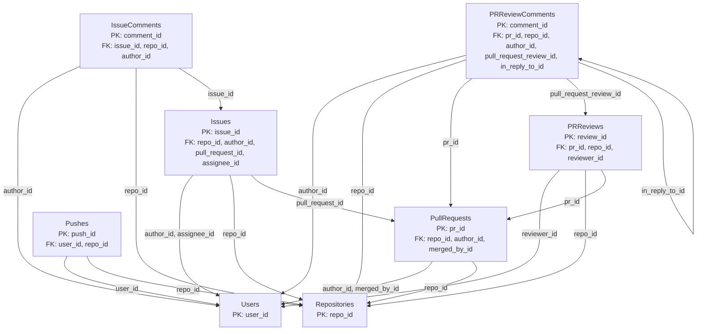

# Question 1: Database Schema Graph

## Dataset

- Source: GH Archive
- Historical period (Taiwan time):
  2026/10/25 00:00 – 2026/11/16 00:00
- Historical period (UTC):
  2026/10/24 16:00 – 2026/11/15 16:00
- Total tables: 8
- Total observed cohort events: 14,113

## Schema Graph

